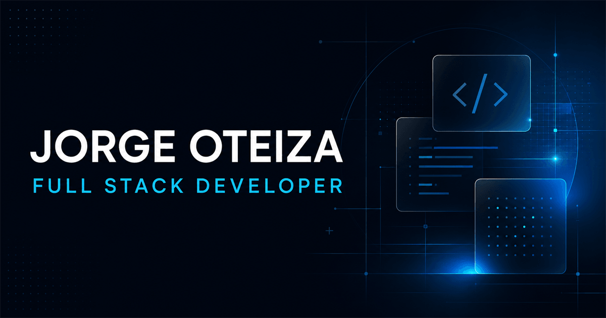

# Jorge Oteiza | Portfolio Full Stack



Portafolio profesional bilingüe (español / inglés) desarrollado en React para presentar proyectos, tecnologías, perfil y datos de contacto. Incluye casos de desarrollo full stack como Minimarket Manager, con POS offline y administración remota, y Travel Calculator, publicado en producción.

- Sitio: <https://jorgeoteiza.github.io>
- Versión en inglés: <https://jorgeoteiza.github.io/?lang=en>

## Características

- Página única con navegación por anclas y menú móvil accesible.
- Fichas de proyecto con galerías en marcos de monitor, tablet y teléfono: botones, arrastre, teclado (Escape y flechas) y foco contenido dentro del modal.
- Selector de idioma ES/EN. El idioma inicial se toma de `?lang=`, de la preferencia guardada o del idioma del navegador.
- Capturas en WebP y logos servidos desde el propio sitio, sin depender de servicios externos.
- El video de fondo solo se carga en pantallas grandes y respeta `prefers-reduced-motion`.

## Estructura

```txt
src/
├── App.js                  # Fondo, proveedor de idioma y orden de secciones
├── components/             # Navbar, Home, Proyectos, Tecnologías, SobreMi, Footer
├── data/proyectos.js       # Contenido de cada proyecto, con textos { es, en }
├── i18n/
│   ├── LanguageContext.jsx # Detección del idioma, useLanguage() y localizar()
│   └── ui.js               # Textos de la interfaz en español e inglés
└── styles/                 # CSS por componente y variables globales
public/
├── projects/<proyecto>/    # Capturas en WebP
└── logos/                  # Logos de tecnologías
```

Para agregar o editar un proyecto, modifica `src/data/proyectos.js`. Cada texto visible se escribe como `t("español", "english")`.

## Requisitos

- Node.js 20 LTS
- npm 10 o superior

## Desarrollo

```bash
npm install
npm start
```

El entorno local estará disponible en `http://localhost:3000`.

## Validación

```bash
npm test -- --watchAll=false --runInBand
npm run build
```

## Tecnologías

- React 18 (Create React App)
- JavaScript y CSS propio
- Bootstrap 5 (solo CSS)
- Jest y React Testing Library
- GitHub Pages

## Despliegue

El proyecto está configurado para publicarse en `https://jorgeoteiza.github.io`.

```bash
npm run deploy
```

Este comando genera el build y publica el contenido mediante `gh-pages`, incluyendo `.nojekyll` para servir los archivos estáticos de React sin procesarlos con Jekyll. La carpeta `build/` no se versiona.
